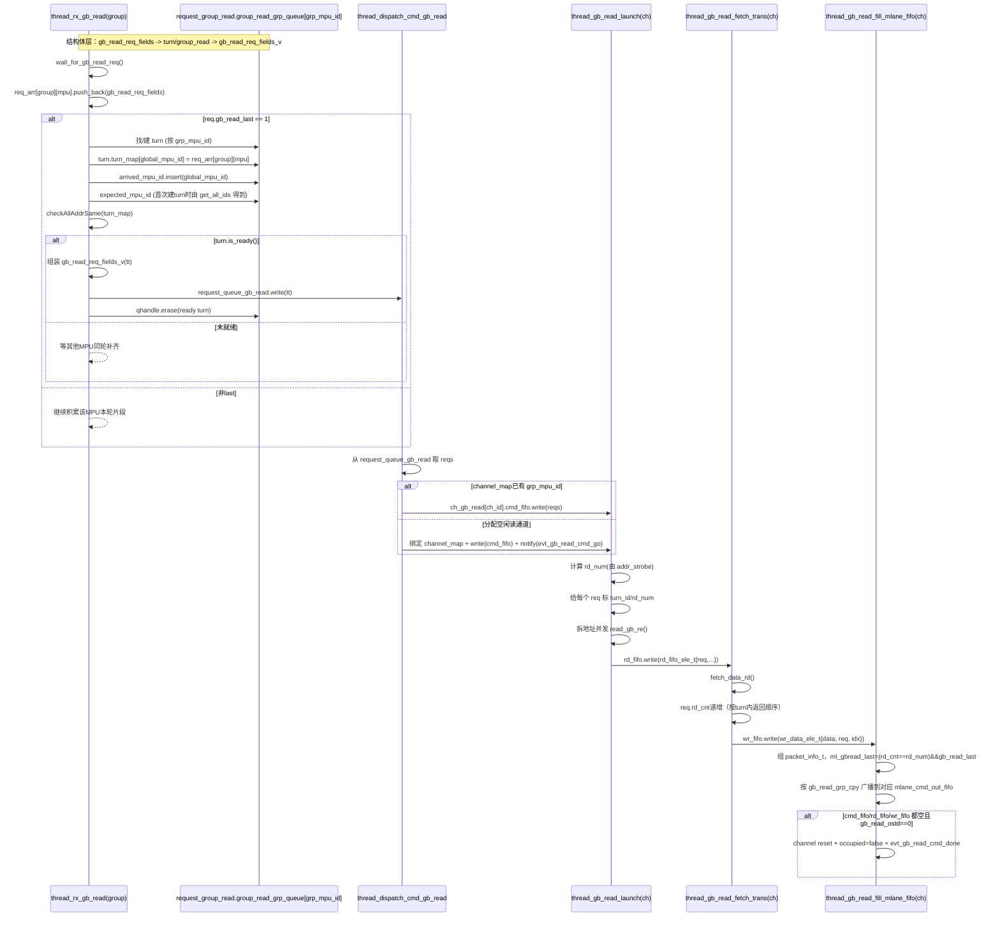

# hello-world
just another repository 

this is my edit file

## if you have any questions, please contact me with my [github](https://github.com/wangqiang1983)

- [ ] _first job_
- [ ] second job
- [x] **already done**

**already done**

Name | Age | Address
-------|--------|----------
Wangqiang| 35 | Hefei
Wangjiaming | 35 | Anhui

# This is new msg for modified

----
****
## this is a new branch

